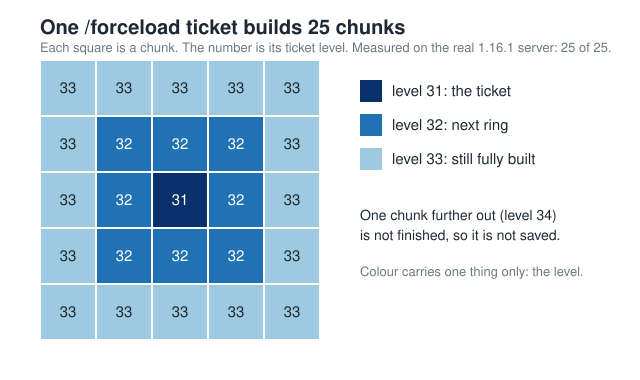
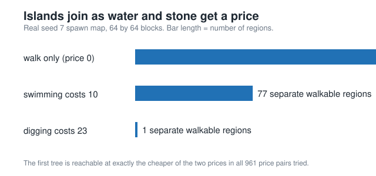
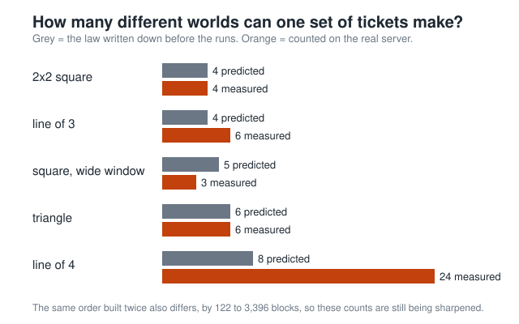

<h1 align="center">sealrun</h1>

<p align="center"><b>Plan the fastest Minecraft run before you start. Then ask: does the world remember how it was built?</b></p>

<p align="center">
  
  
  
</p>

<p align="center"><b>Invented by <a href="https://teerthsharma.vercel.app/">Teerth Sharma</a></b> · <a href="mailto:teerths57@gmail.com">teerths57@gmail.com</a></p>

---

## What is this?

Every Minecraft world grows from one number, called the **seed**. The same seed always gives the same hills, rivers and caves. That is why people race on a fixed seed. A race to finish the game as fast as possible is called a **speedrun**.

sealrun reads the map before the run starts. It finds the places you can walk between, where water or stone blocks the way, and what it costs to swim or dig through. Then it plans the quickest route. Same seed, same plan, every time.

It also asks a new question. Minecraft does not build the whole world at once. It builds it in square pieces called **chunks**, and it builds the ones near you first. So the way you explore decides the order the chunks are built in. Does that order change the world? We tested it on a real Minecraft server.

You do not need any maths to read this page. Every special word is explained in [Words we use](#words-we-use) at the bottom.

## What we found

Every result here comes from a real Minecraft 1.16.1 server on seed 7.

- **One command builds 25 chunks, not 1.** The `/forceload` command finishes a 5 by 5 block of chunks around the spot you pick. The Minecraft wiki said so, and the server agreed: 25 of 25.
- **Build order can change the world.** We built a square of 4 chunks in 4 different orders and got 4 different worlds.
- **The change is small.** In one chunk, iron plus gold came to 163 in every world. One order traded 2 iron for 2 gold. **Diamonds never moved.**
- **Sometimes the world forgets.** Two different build orders gave exactly the same world, down to every block. Looking at that world, nobody can tell which order made it.
- **The new planner gets out of spawn.** Our first planner found no route from any of the 1,417 open spots near spawn. None of them can walk to a tree, so it never got wood. The new planner can dig and swim, and its route from spawn takes 538 ticks (about 27 seconds of game time).
- **Spawn is a group of islands.** Near spawn there are 158 separate areas you can walk around in. If swimming costs 10, they join into 77. If digging costs 23, they join into 1.
- **Given enough time, both planners reach every start.** With one million search steps, the new planner and a plain search both find a route from all 179 start points. With only 10,000 steps, the plain search does better (67 against 13). When both find a route, the new planner's route is never slower.
- **We found no one who wrote this down before.** We read 53 sources: the Minecraft wiki, bug reports and maths papers. None of them says how build order shapes a Minecraft world.
- **The Blood Lab rebuilt 15 of 16 known results.** AI agents rebuilt known maths results from scratch, and each one had to print the same number as the original. Two examples: 104 of 256 simple rules that do not care about update order, and 200 random maps where two ways of counting islands agree.
- **Our counting matches a known pattern.** Our first-build rule sorts the 24 build orders of 4 chunks into 14 groups. These are exactly the 14 groups that "binary search trees" make, a pattern mathematicians already study.

## What we got wrong

We write down our guess before each test. Then we keep the result, even when it says no.

- **Our first rule was wrong.** We guessed that the first build to reach a chunk decides how that chunk looks. On a ring of five chunks, the rule said 5 different worlds. The server made 6.
- **A wider rule was mostly wrong too.** We let each chunk feel builds up to 4 chunks away. It explained only 19 of the 102 chunks that changed. All 19 sat exactly 4 chunks away, where luck alone would give about 6. So it is a clue, not an answer.
- **A spacing test also said no.** With builds 5 or 7 chunks apart, the rule said there would be only 1 world. The server made 6 different worlds from 6 orders.
- **Our groups were not tidy.** If a rule is right, orders that give the same world should sit close together. We checked the 3 groups that hold more than one order. All 3 split into two separate pieces.
- **The same order does not always give the same world.** See [The puzzle we are still solving](#the-puzzle-we-are-still-solving).

## See it: one command, 25 chunks

<p align="center"></p>

The forced chunk starts at level 31. Each step away adds 1. Chunks at level 33 or lower are fully built. That reaches 2 chunks out in every direction, so you get a 5 by 5 block. The picture shows what the real server did.

Why it matters: if a second build lands inside a block that is already finished, it has nothing left to build. That gave us our first guess, that the first build in an area decides everything. The server showed that guess was wrong.

## The ideas, in plain words

**Two orders, one world.** Chunks A and B sit side by side, and a patch of granite crosses the line between them. Build A first and the patch comes out one way. Build B first and it can come out as andesite instead. So a world keeps a faint mark of what was built first.

**Counting worlds.** You can build 4 chunks in 24 different orders (4 × 3 × 2 × 1). Put the orders that give the same world into one group. The number of groups is the number of different worlds. Our first rule said 24 orders would give 4 worlds, with 6 orders in each group. We never ran all 24, so that stays a guess.

**What the world forgets.** If 6 orders all give the same world, the world cannot tell you which of the 6 happened. To find out, you would need about 2.6 yes-or-no questions. That is how much history the world has lost. This number comes from the guess above, not from a test.

**Islands and prices.** Most route planners treat water and stone as walls. We treat them as "you can cross, but it costs time". With no price at all, the spawn map is 158 islands. As the price goes up, the islands join together.

<p align="center"></p>

In all 961 price pairs we tried, the first tree became reachable at exactly the cheaper of the two prices.

## The rule against the real server

<p align="center"></p>

Grey bars show what our first rule said, written down before the tests. Orange bars show what the server did. One layout matched. The others did not.

## The puzzle we are still solving

**Building the same order twice does not always give the same world.** Two runs of one order differed by up to 3,396 blocks. Most of the differences sit 2 to 3 chunks from where we built, where chunks are only half finished. Each odd chunk came out in only 2 to 4 versions, so this is not random mess. 59 to 63% of the changed blocks sit on the outer edge of a chunk, where an even spread would put 23%. Most of them are granite, andesite and diorite patches.

Was another program on the computer causing it? We ran the same order 6 more times with only one Minecraft server running and nothing else. 15 of 25 chunks still came out differently. So the cause is inside Minecraft itself.

Our best guess: when a stone patch crosses a chunk edge, whichever chunk is decorated first places it. Minecraft decorates chunks on several threads at once, so their timing works like a hidden second build order. We are still testing this.

## Routes on real terrain

| Search steps allowed | New planner finds a route | Plain search finds a route |
|---|---|---|
| 10,000 | 13 of 179 | 67 of 179 |
| 100,000 | 178 of 179 | 177 of 179 |
| 1,000,000 | 179 of 179 | 179 of 179 |

Both got the same number of steps, from the same 179 start points on the spawn map.

- Planned on a saved map. Not yet checked against the live server, and not yet played in the game.
- At 10,000 steps the planner routes fewer starts, so "never slower" only holds at 100,000 steps or more.

## How we built it

**Round 1: the planner.** Three small programs written in Rust. `world` turns a seed into a map, the same every time. `topo` counts separate areas and keeps the count up to date when you mine a block. `route` finds the cheapest route. On a test map where you need a stone pickaxe to pass a wall, the planner takes 485 ticks and plain search takes 573.

**Round 2: a real server.** Python scripts start a real Minecraft server, build chunks, save, stop, and read the saved world files. One new world takes about 20 seconds and less than 1 GB of memory.

**Round 3: the rule.** We wrote down a rule, saved it, and only then tested it. It lost. A wider rule lost on most chunks too. Both results stay on this page.

**The Blood Lab.** 16 known results from papers, bug reports and algorithms, rebuilt in code in `lab/blood/`. 15 are done. Each one must print the same number as its source, or it does not go in.

**The bug hunt.** We look for real bugs in our own code in six areas. Each area says up front how many checks it will run and how many bugs end the hunt. A bug only counts if a test fails on today's code and shows the wrong answer.

**Who did the work.** Teerth Sharma asked the questions. AI helped write the code. Every claim here has a test behind it.

## Words we use

| Word | What it means |
|---|---|
| Seed | The number a Minecraft world is made from. Same seed, same world. |
| Speedrun | A race to finish the game as fast as possible. |
| Chunk | A 16 by 16 column of blocks. Minecraft builds the world one chunk at a time. |
| Build order | The order in which chunks get built. |
| `/forceload` | A Minecraft command that makes the game build a chunk and keep it loaded. |
| Level | A number Minecraft gives each chunk. Lower means more fully built. |
| Tick | One step of game time. 20 ticks make one second. |
| Route | A path from start to goal, with every step on the way. |
| Island | An area you can walk around in without swimming or digging. |
| Yes-or-no question | The unit we use to measure lost history. Maths calls it a bit. |

## Try it yourself

You need Rust (stable) and Python 3.11. The real-server tests also need your own Minecraft 1.16.1 server file, which is not included here.

```bash
cargo test --workspace
cargo clippy --workspace --all-targets -- -D warnings

python lab/tests/test_n3_bits_hand.py Lab.bits_lost_square_is_log2_six
python lab/tests/test_ores.py Lab.ore_tally_counts_per_chunk

python site/serve.py     # the goal page, http://localhost:7740
```

To use a real server:

```bash
export SEALRUN_SERVER="/path/to/server-1.16.1"   # only read, never changed
export SEALRUN_JAVA="/path/to/java"
python lab/tests/test_forceload_tile.py Lab.forceload_tile_full_at_0_to_2_and_not_saved_at_3
```

Each test world lives in a temporary folder outside this project and is deleted afterwards. No Minecraft game files are ever saved here.

## What is in this folder

```
crates/world   seed to map, same seed, same map
crates/topo    walkable areas, loops, updates when a block changes
crates/route   the planner, plain search, dig and swim costs
lab/           scripts that run the real server and read its saves
lab/research/  the rule tests, the group checks, the price curve
lab/blood/     the Blood Lab rebuilds
site/          the goal pages
docs/          the pictures on this page
```
